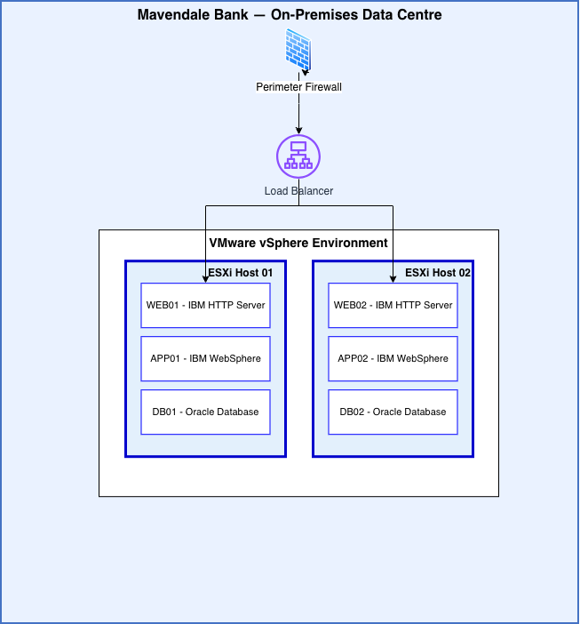
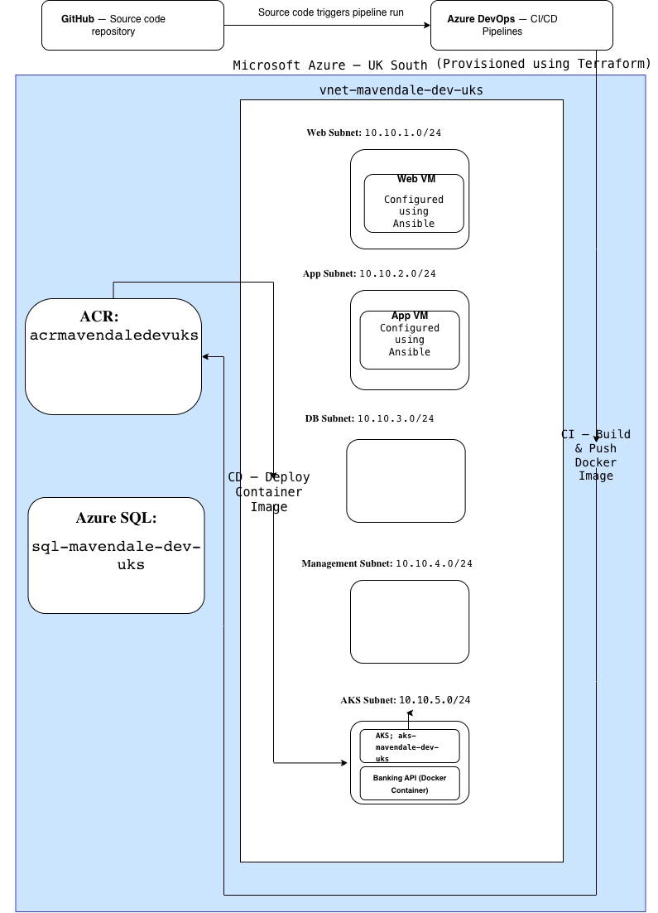

# Mavendale Bank — On-Premises to Azure Cloud Migration & DevOps Modernisation

## Project Overview
A hands-on portfolio project simulating the migration of a fictional bank's on-premises infrastructure to Microsoft Azure, alongside the introduction of Infrastructure as Code, configuration management and CI/CD automation.

## Architecture
**On-Premises (AS-IS):** VMware vSphere environment hosting web, application and database workloads.

**Azure (TO-BE):** Azure VNet with segmented Web, App, DB and Management subnets, alongside Azure VMs, AKS, ACR and Azure SQL.

### On-Premises Architecture (AS-IS)

### Azure Architecture (TO-BE)

## Technologies
- **Cloud:** Microsoft Azure
- **Infrastructure as Code:** Terraform
- **Configuration Management:** Ansible
- **CI/CD:** Azure DevOps Pipelines
- **Source Control:** Git and GitHub
- **Containers:** Docker, Azure Kubernetes Service (AKS)
- **Container Registry:** Azure Container Registry (ACR)
- **Database:** Azure SQL Database
- **Automation:** Bash, Azure CLI and kubectl

## Phase 1 — Implementation
- Provisioned Azure networking, subnets, NSGs and infrastructure using Terraform.
- Configured Web and App VMs using Ansible.
- Implemented Azure DevOps pipelines for Terraform and application deployments.
- Containerised a Python Banking API using Docker.
- Built and pushed container images to ACR.
- Automated Banking API deployment to AKS.
- Configured Kubernetes Secrets for SQL database connectivity.
- Implemented branch-based deployment controls.

## Validation
- Successfully executed CI/CD pipelines.
- Verified AKS deployment and Pod health.
- Tested Banking API `/health` endpoint.
- Confirmed Azure SQL connectivity using `/db-health`.
- Verified deployment image versions against Azure DevOps pipeline runs.

## Phase 2 — Planned Enhancements
- Advanced cloud security and vulnerability management.
- Monitoring, logging and alerting.
- High availability, resilience and disaster recovery.
- Networking and identity security improvements.
- Production environment and deployment enhancements.

## Project Documentation
See [Project Progress Journal](docs/project-progress.md) for implementation notes and technical decisions.